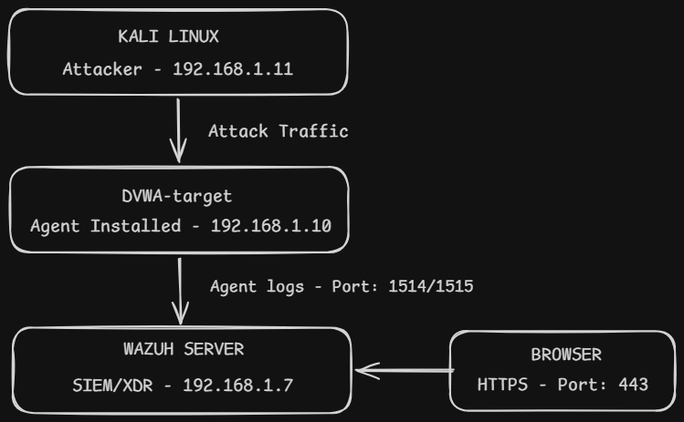

# Wazuh SIEM/XDR Attack-Defend Lab

Hands-on SIEM/XDR lab using Wazuh, Kali Linux, and DVWA to simulate and detect common attack scenarios mapped to MITRE ATT&CK.

## Overview
This project demonstrates end-to-end security operations workflow: deploying a Wazuh SIEM/XDR platform, executing realistic attack scenarios against a vulnerable target, and analyzing detection coverage — including honest documentation of what Wazuh's default configuration does and does NOT catch.

## Architecture

| Component | Role | Details |
|---|---|---|
| Wazuh Server | SIEM/XDR (manager + indexer + dashboard) | Debian, all-in-one deployment |
| Kali Linux | Attacker | Nmap, Hydra, Ncrack, sqlmap |
| DVWA-target | Target (agent installed) | Debian + Docker + DVWA |

**Note**: Metasploitable2 was initially provisioned but excluded from the final attack chain due to a 32-bit architecture incompatibility with modern Wazuh agent builds — a real-world constraint documented as a lesson learned rather than hidden.

## Scenarios Tested

| # | Scenario | MITRE ATT&CK | Default Detection | Severity |
|---|---|---|---|---|
| 01 | Network Reconnaissance (Nmap) | T1046 | Not detected | Low |
| 02 | Brute Force (SSH) | T1110.001 | Detected (rule 5760) | Critical (successful auth) |
| 03 | SQL Injection (DVWA) | T1190 | Not detected | High |
| 04 | File Integrity Monitoring | T1565.001 | Partial (tracked, not alerted) | Low-Medium |

Full technical detail, commands, and screenshots for each scenario are in [`scenarios/`](scenarios/).

## Key Finding
Across four tested scenarios, Wazuh's default configuration reliably detects **authentication-based attacks** but has **significant blind spots** for network- and application-layer attacks without additional log sources (Apache logs, NIDS integration) and rule tuning. An attempt to close the reconnaissance detection gap via custom `auditd` integration is documented in detail in [`scenarios/01-recon-nmap.md`](scenarios/01-recon-nmap.md), including the iterative debugging process and root cause analysis.

## Incident Response
Runbooks for each scenario type, including severity classification and escalation steps, are in [`runbooks/`](runbooks/).

## Repository Structure
├── architecture/ # Network topology diagram
├── custom-rules/ # Custom Wazuh rules (local_rules.xml attempts)
├── runbooks/ # Incident response runbooks per scenario type
├── scenarios/ # Detailed per-scenario reports with evidence
└── screenshots/ # Supporting evidence for all scenarios

## Lessons Learned
- Wazuh installation and troubleshooting (dpkg state management, IO-APIC kernel panics on legacy VMs, timezone sync across VMs)
- Custom rule development is iterative — two rule iterations and a full root-cause investigation were needed before concluding the auditd approach required further scoping
- Default SIEM configurations have real, documented blind spots — identifying and documenting these is as valuable as a successful detection

## Tools Used
Wazuh 4.14.9, Kali Linux, DVWA (Docker), Nmap, Hydra, Ncrack, sqlmap, VirtualBox

## Note on AI Assistance
This project was developed with AI assistance (Claude) for research, troubleshooting, and documentation structuring. All hands-on execution — running commands, interpreting results, debugging failures, and making operational decisions — was performed directly by the author.

## Author
Daffa Murtadha — D4 Rekayasa Keamanan Siber, Politeknik Negeri Batam
