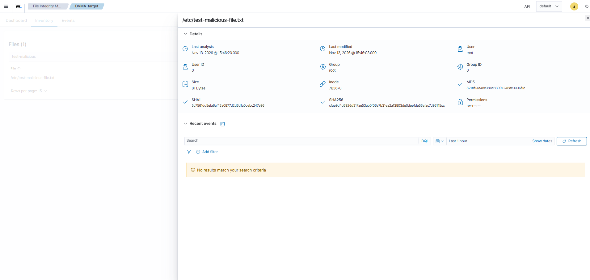
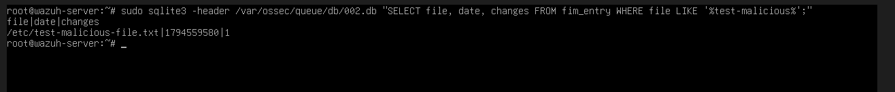
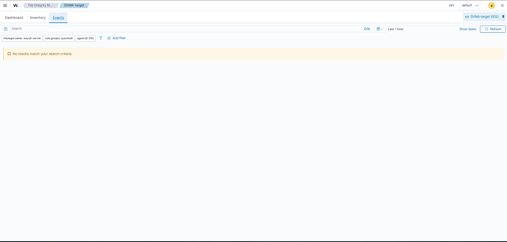

# Scenario 04: File Integrity Monitoring (FIM)

## Objective

Simulate unauthorized file modification in a monitored directory to test Wazuh's File Integrity Monitoring (FIM/syscheck) detection capability.

## MITRE ATT&CK Mapping

- **Technique**: T1565.001 - Data Manipulation: Stored Data Manipulation
- **Tactic**: Impact

## Environment

- **Target**: DVWA-target (192.168.1.10), agent ID 002
- **Monitored directories**: /etc, /usr/bin, /usr/sbin, /bin, /sbin, /boot
- **Monitoring**: Wazuh Server (wazuh-server)

## Simulation Steps

```bash
sudo touch /etc/test-malicious-file.txt
echo "suspicious content for FIM test" | sudo tee -a /etc/test-malicious-file.txt
sudo /var/ossec/bin/wazuh-control restart
```

## Detection Result

### Level 1: Database (Confirmed)

File tracked in FIM database, verified via direct SQL query on the manager:

```bash
sudo sqlite3 -header /var/ossec/queue/db/002.db "SELECT file, date, changes FROM fim_entry WHERE file LIKE '%test-malicious%';"
```

Result:

```
file|date|changes
/etc/test-malicious-file.txt|1794559580|1
```

### Level 2: Dashboard Inventory (Confirmed)

File fully visible in the FIM Inventory module with complete forensic metadata:

| Attribute | Value |
|---|---|
| Path | /etc/test-malicious-file.txt |
| Last analysis | Nov 13, 2026 @ 15:46:20 |
| Last modified | Nov 13, 2026 @ 15:46:03 |
| Size | 81 Bytes |
| User / Group | root / root |
| Permissions | rw-r--r-- |
| Inode | 783670 |
| MD5 | 821bf14a48c384e83997248ae3036f1c |
| SHA1 | 5c7561dd5efa6af43a0877d2d6d1a0cebc247e96 |
| SHA256 | cfae9d4d6926d317ae53ab0f06a7b31ea2a13803de0dee1de56afac7d93115cc |

### Level 3: Alert/Events (NOT Detected)

Filtered by `rule.groups: syscheck`, `agent.id: 002`, last 1 hour — result: **"No results match your search criteria"**. No formal alert was generated despite confirmed tracking at both database and inventory level.

## Screenshot Evidence





## Analysis

This scenario produced a partial detection result that differs from the previous two scenarios (Nmap and SQL Injection), which showed zero detection at any level. Here, FIM successfully tracked the file modification at the **data layer** — confirmed directly via SQLite query on the manager's FIM database (`fim_entry` table, `changes: 1`) and fully visible in the dashboard's **Inventory** view.

The Inventory view confirms comprehensive file metadata was captured, including MD5, SHA1, and SHA256 checksums, exact modification timestamp, file permissions, and ownership — demonstrating that Wazuh's FIM engine performs thorough forensic-level tracking at the data layer, independent of whether an alert is triggered.

However, this tracked change did **not escalate into a formal alert** visible in the Events/Threat Hunting view, even after confirming Filebeat was active and properly shipping data to the indexer. This suggests the gap is not in data collection or transport, but likely in **rule-matching logic within `analysisd`** — Wazuh's default ruleset may only generate alerts for specific FIM events (e.g., changes to security-critical files like `/etc/passwd`, `/etc/shadow`) rather than all monitored file changes indiscriminately. A generic test file in `/etc` may simply not match any rule condition severe enough to trigger an alert, even though it is correctly tracked.

This is a nuanced and valuable finding: **FIM data collection works correctly, but alert generation depends heavily on rule specificity** — a distinction that matters operationally, since an analyst relying solely on the Events/alert view would miss this change entirely, despite the underlying monitoring functioning as designed.

## Severity Classification

**Low-Medium** — the file modified was a test file in a monitored directory, not a security-critical system file. Had this been a modification to `/etc/passwd` or `/etc/shadow`, default rules would very likely have triggered a Critical-level alert, consistent with Wazuh's documented behavior for those specific files (observed as explicit "No diff for file" log entries for `/etc/shadow` during normal baseline scans).

## Recommendation

1. **Test with security-critical files** (e.g., a controlled, reversible modification to `/etc/passwd` or `/etc/hosts`) to confirm whether default rules trigger alerts for genuinely sensitive targets — the current test file likely fell outside default rule scope.
2. **Review and customize FIM-related rules** in `local_rules.xml` to generate alerts for a broader range of monitored file changes, not just a predefined critical-file list.
3. **Do not rely on Inventory view alone for real-time detection** — Inventory reflects current state, not time-sensitive alerting; Events/alerts remain the correct mechanism for incident response, so the rule gap identified here should be prioritized for remediation.
4. Document this finding as a key architectural insight: **default Wazuh FIM alerting is selective, not exhaustive** — a critical consideration when scoping what "file integrity monitoring" actually covers in a production deployment.

## Active Response

*Not applicable — no alert was generated to trigger a response action.*
